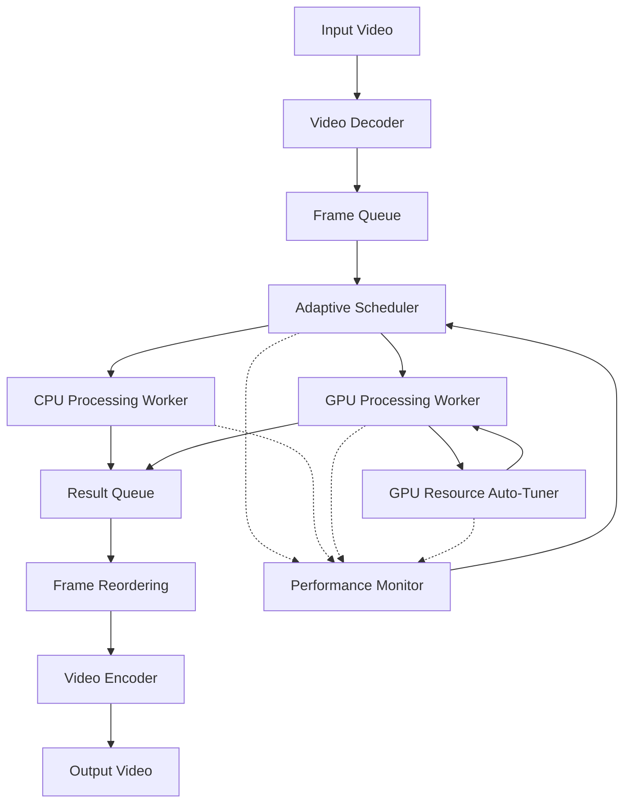
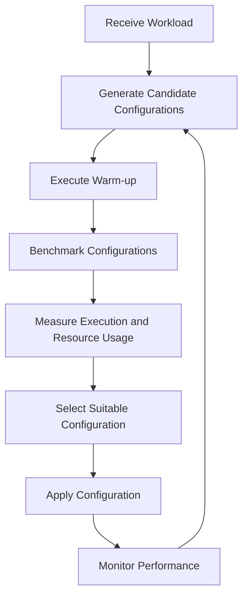
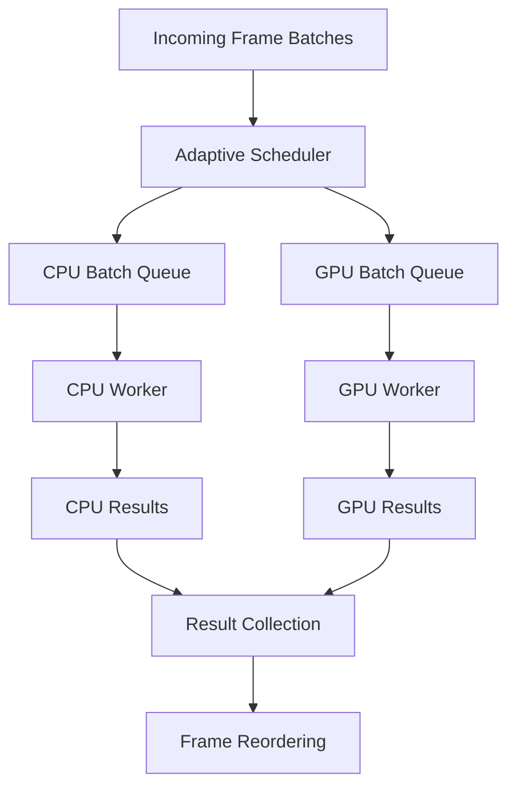

<div align="center">

#  Adaptive CPU–GPU Scheduler

### An Architecture-Aware Adaptive Scheduling Framework for Heterogeneous Video Processing

**Making CPU and GPU work together intelligently.**

<br>


<br>

[Overview](#-overview) •
[Architecture](#-system-architecture) •
[Algorithms](#-core-algorithms) •
[Benchmarking](#-performance-evaluation) •
[Roadmap](#-development-roadmap)

</div>

---

##  Overview

Modern video-processing workloads involve multiple computationally intensive operations. CPUs and GPUs have different architectural strengths, but using only one processor may leave valuable computing resources underutilized.

**Adaptive CPU–GPU Scheduler** aims to address this problem through an adaptive scheduling framework that coordinates CPU and GPU execution on a single heterogeneous machine.

Instead of relying on a fixed execution strategy, the framework estimates workload costs, monitors resource utilization, and dynamically determines how processing tasks should be distributed.

###  Project Goals

-  Develop parallel video-processing pipelines.
-  Implement adaptive CPU–GPU workload scheduling.
-  Automatically tune GPU execution resources.
-  Overlap CPU and GPU computation where beneficial.
-  Evaluate execution time and hardware resource utilization.
-  Identify configurations that improve overall system performance.

---

## System Architecture

The framework is organized around three major components:

| Component | Responsibility |
|:---|:---|
| **A9 – GPU Resource Auto-Tuner** | Determines suitable GPU execution configurations. |
| **A10 – Adaptive CPU–GPU Scheduler** | Decides how workloads should be distributed between CPU and GPU. |
| **A11 – Integrated Scheduler** | Combines scheduling and GPU auto-tuning into one system. |

### High-Level Architecture



### Processing Pipeline

The initial video-processing workload consists of the following stages:


The framework will investigate parallel execution across independent frames and pipeline stages.

---

##  Core Algorithms

<details open>
<summary><strong> A9 — GPU Resource Auto-Tuner</strong></summary>

### Objective

Automatically identify suitable GPU execution configurations for the current workload.

GPU performance depends on several configuration parameters. Increasing the number of CUDA streams or buffers does not necessarily improve performance.

### Parameters to Tune

- CUDA stream count.
- Frames in flight.
- Batch size.
- GPU buffer count.
- Queue capacity.
- CPU–GPU execution overlap.

### General Workflow



The tuner will consider execution time, GPU memory usage, and resource contention when evaluating configurations.

</details>

<details open>
<summary><strong> A10 — Adaptive CPU–GPU Workload Scheduler</strong></summary>

### Objective

Determine how much work should be assigned to the CPU and GPU based on estimated execution costs and current system conditions.

The scheduler will evaluate three execution strategies:

| Strategy | Description |
|:---|:---|
| CPU-only | CPU performs the image-processing workload. |
| GPU-only | GPU performs the image-processing workload, while the CPU manages supporting operations. |
| Hybrid | CPU and GPU process separate workloads concurrently. |

### Cost Estimation

The scheduler considers:

- CPU computation time.
- GPU computation time.
- Host-to-device transfer time.
- Device-to-host transfer time.
- Synchronization overhead.
- Queue waiting time.
- Resource availability.

The estimates will be updated using an Exponential Moving Average (EMA):

\[
E_{new} = \alpha T_{actual} + (1-\alpha)E_{old}
\]

Where:

- \(E_{new}\) = Updated execution-time estimate.
- \(T_{actual}\) = Latest measured execution time.
- \(E_{old}\) = Previous estimate.
- \(\alpha\) = Smoothing factor.

This allows the scheduler to adapt its estimates as workload characteristics change.

### Hybrid Execution Concept



The CPU and GPU can process different independent batches simultaneously rather than waiting for one processor to finish all its work before the other starts.

</details>

<details open>
<summary><strong>🔗 A11 — Integrated Adaptive Scheduler</strong></summary>

### Objective

Integrate A9 and A10 into a unified scheduling framework.

The integrated system will coordinate:

1. Workload distribution between CPU and GPU.
2. GPU execution configuration.
3. Resource monitoring.
4. Execution-time estimation.
5. Adaptive configuration updates.

The goal is to improve end-to-end pipeline performance rather than optimize an isolated processing stage.

</details>

---

##  Performance Evaluation

Performance evaluation is a central part of this project.

The framework will compare multiple execution strategies under controlled workloads.

### Planned Baselines

| Configuration | Description |
|:---|:---|
| Sequential CPU | Single-threaded CPU execution. |
| Multithreaded CPU | Parallel CPU execution. |
| Static CPU | Fixed CPU worker configuration. |
| GPU | GPU-based image processing. |
| GPU Streams | Different CUDA stream configurations. |
| Hybrid | Concurrent CPU and GPU processing. |
| Adaptive | Scheduling using A10 and A9. |

### Performance Metrics

| Metric | Purpose |
|:---|:---|
| Execution Time | Measure total processing time. |
| Throughput | Measure frames processed per second. |
| CPU Utilization | Evaluate CPU resource usage. |
| GPU Utilization | Evaluate GPU activity. |
| RAM Usage | Monitor host memory consumption. |
| VRAM Usage | Monitor GPU memory consumption. |
| Transfer Time | Measure CPU–GPU data transfer overhead. |
| LLC Cache Misses | Investigate CPU cache behavior. |
| Resource Overlap | Evaluate concurrent CPU–GPU execution. |

### Benchmark Results

>  Benchmark results will be added after implementation and controlled experiments.

| Execution Strategy | Execution Time | Throughput | CPU Usage | GPU Usage |
|:---|:---:|:---:|:---:|:---:|
| Sequential CPU | TBD | TBD | TBD | N/A |
| Multithreaded CPU | TBD | TBD | TBD | N/A |
| GPU | TBD | TBD | TBD | TBD |
| Hybrid | TBD | TBD | TBD | TBD |
| Adaptive | TBD | TBD | TBD | TBD |

---

## Technology Stack

| Technology | Purpose |
|:---|:---|
| C++ | Core implementation |
| CUDA C++ | GPU computation |
| OpenCV | Video and image processing |
| OpenMP | CPU parallel processing |
| CMake | Build configuration |
| Linux / Ubuntu | Development environment |
| NVIDIA Nsight Systems | Performance profiling |
| Git | Version control |

*The technology stack may evolve during implementation.*

---

## Development Environment

The initial development and evaluation environment includes:

| Component | Hardware |
|:---|:---|
| CPU | Intel Core i7-12700H |
| GPU | NVIDIA GeForce RTX 3050 Laptop GPU |
| GPU Memory | 4 GB |
| System RAM | 16 GB |
| Operating System | Ubuntu Linux |

Additional experiments may be conducted using university machines equipped with NVIDIA RTX 2060 GPUs.

---

## Development Roadmap

- [x] Project repository initialization
- [x] Initial project architecture and objectives
- [ ] CUDA and CPU parallel-processing foundations
- [ ] Video-processing pipeline implementation
- [ ] Sequential CPU baseline
- [ ] Multithreaded CPU baseline
- [ ] GPU processing implementation
- [ ] A9: GPU Resource Auto-Tuner
- [ ] A10: Adaptive CPU–GPU Scheduler
- [ ] Hybrid execution implementation
- [ ] A11: Integrated scheduling framework
- [ ] Performance profiling and benchmarking
- [ ] Experimental analysis and optimization
- [ ] Final demonstration and documentation

---

## Project Structure

The repository structure will evolve as the implementation progresses.

```text
adaptive-cpu-gpu-scheduler/
│
├── README.md
├── LICENSE
│
├── docs/
│   ├── architecture/
│   └── reports/
│
├── src/
│   ├── pipeline/
│   ├── cpu/
│   ├── gpu/
│   ├── scheduler/
│   ├── tuner/
│   └── monitoring/
│
├── include/
│
├── tests/
│
├── benchmarks/
│
├── scripts/
│
└── CMakeLists.txt
```

---

## Getting Started

Implementation and build instructions will be added as the initial pipeline and processing modules become available.

### Prerequisites

- Ubuntu Linux
- C++ compiler
- CMake
- NVIDIA GPU with compatible CUDA support
- CUDA Toolkit
- OpenCV

### Future Build Instructions

```bash
# Clone the repository
git clone git@github.com:pinsara23/adaptive-cpu-gpu-scheduler.git

# Enter the project directory
cd adaptive-cpu-gpu-scheduler

# Configure the project
cmake -S . -B build

# Build
cmake --build build -j$(nproc)
```

---

## Project Information

This is a five-credit High Performance Computing project conducted over two academic semesters.

**Primary focus:** Parallel computing, heterogeneous computing, resource-aware scheduling, and performance optimization.

---

##  References

Technical documentation and research references will be maintained here as the implementation and literature review progress.

- [NVIDIA CUDA C++ Programming Guide](https://docs.nvidia.com/cuda/cuda-c-programming-guide/)
- [NVIDIA Nsight Systems Documentation](https://docs.nvidia.com/nsight-systems/)
- [OpenCV Documentation](https://docs.opencv.org/)
- [OpenMP Documentation](https://www.openmp.org/specifications/)

---

<div align="center">

###  Building an intelligent bridge between CPU and GPU computing.

**Developed by [Pinsara Sarathchandra](https://github.com/pinsara23)**

[GitHub Repository](https://github.com/pinsara23/adaptive-cpu-gpu-scheduler)

</div>